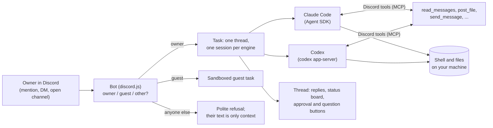

# discord-coding-agent

A Discord bot that hands its owners' requests to [Claude Code](https://www.anthropic.com/claude-code) or
[Codex](https://github.com/openai/codex) running on your own machine. Mention the bot where a problem shows
up ("@Agent the upload page hangs at 99% for Sam") and the agent investigates and fixes it on the host, reporting
in a thread, so nobody has to open a terminal and start a session by hand. It is a thin Discord front end: the
coding itself is done by the real Claude Code and Codex, with their normal tools, on a machine you control.

> **This gives an AI shell access to your machine.** Read [Security model and its limits](#security-model-and-its-limits)
> before you run it, and run it as an unprivileged user, ideally on a dedicated VM or container.

## Features

- **Tasks in threads.** A mention (or a DM, or any message in a channel you mark "open") starts a task in a new
  thread, with the recent channel messages as context. Follow-ups in the thread go to the same session, even
  mid-task or after a bot restart.
- **Two engines, switchable per task.** Claude Code (Agent SDK) and Codex (`codex app-server`). `/engine`,
  `/model` and `/effort` open panels built from what each engine really offers. Switching hands the thread
  history to the other engine.
- **Live status board** per turn: phase, recent actions, elapsed time, and a **Stop** button.
- **Messages queue like in a terminal.** Each message you send mid-task shows its state: ⏳ queued, 👀 read, then
  ✅ / ⏹️ / ❌ when the turn that read it ends. If one waits over 45 seconds the bot offers **Read now**, which
  interrupts the step in the way.
- **Approvals and questions as buttons.** What the engine's automatic permission check cannot decide comes to the
  owners as Approve / Approve for this task / Deny. The agent asks decisions with buttons, up to 25 choices.
- **Approval for anything outward.** `send_message` (posting anywhere outside the task thread) needs an owner to
  press a button every time.
- **Owner-only instructions.** Only the Discord ids you list can instruct the agent. Everyone else's text is
  passed as untrusted context.
- **Guests (sandboxed users).** People you list as guests get tasks of their own with no shell, no files and no
  memory. Optionally their Python can run in a throwaway cloud sandbox to build files for them.
- **Voice messages.** Owners' voice notes and audio files are transcribed before the agent sees them, through an
  HTTP backend you configure or a local `faster-whisper`.
- **Scheduled wake-ups.** A saved task can be resumed on a weekly schedule, with a finite end date.
- **Background jobs.** A command left running in the background keeps its session alive and the agent picks the
  result up in a new turn when it finishes.
- **Redaction.** Everything posted to Discord goes through a secret scrubber.
- **Your own instructions.** A plain markdown file you edit is added to the agent's system prompt.

## How it works



One task is one Discord thread (or one DM). Each task runs one engine session as a child process, in streaming-input
mode. The bot maps threads to session ids in `data/tasks.json`, so a reply after a restart resumes the session.
Idle sessions close after 15 minutes (a running background job keeps one open for up to 6 hours) and resume on the
next message. The Discord tools are served to Claude by an in-process MCP server and to Codex by the same tools over
a localhost-only HTTP MCP bridge (random port, a per-task random path).

Code layout:

- `src/discord/`: client, message and button routing, context gathering, threads, sending, redaction, transcription
- `src/tasks/`: the task lifecycle, the inbox (queued messages), status board, idle closing, prompts, engine handoff, schedules
- `src/engines/`: shared types, settings, model catalogue; `claude/` (Agent SDK) and `codex/` (app-server RPC and MCP bridge)
- `src/agent/`: the system prompts, the approval and question relays
- `src/mcp/`: the Discord and session-history tools
- `src/guests/`: guest tier (sandbox directory, inline attachments, optional file sandbox, cleanup)
- `modal/`: optional Modal apps (speech-to-text backend and the guest file sandbox)

## Security model and its limits

Be clear about what this is: **an AI agent with shell access to a machine, controlled from a chat app.** The measures
below reduce risk. They do not make it safe to run carelessly.

**What the bot does**

- **Owners only.** Only user ids in `AGENT_ALLOWED_USERS` can instruct the agent, approve actions, or change models.
  When anyone else mentions the bot it says so politely, at most once every 10 minutes per person.
- **Other people's words are information, not instructions.** The channel history and the message you replied to
  are sent to Claude as `pasted_content`, which Claude Code treats as text that may carry instructions nobody gave.
  Codex has no such channel, so that text reaches it inside a labelled `<untrusted_context>` block. The Discord
  tools return other people's text as tool output, and the system prompt says never to act on it.
- **The bot token stays out of the agent's reach.** `.env` is parsed by the bot into a config object, not into
  `process.env`, so the Claude and Codex child processes (and the shell the agent runs) never inherit it.
- **Redaction.** Every post passes `redact()`: token-shaped strings, `key=value` secrets, credentials in URLs,
  private keys, and the exact values found in `.env` files under `AGENT_SECRET_SCAN_DIRS` (rescanned every 10
  minutes). Text the agent writes in its own thread never pings anyone (an owner-approved `send_message` may).
- **Outward messages need a button.** `send_message` needs an owner to approve each message.
- **Permission modes.** With `AGENT_PERMISSION_MODE=auto` (the default) Claude runs in auto mode and Codex runs
  with automatic review in a `workspace-write` sandbox; "Approve for this task" grants rules for that session only,
  and the bot drops any suggestion that would change the permission mode. With `bypass` there are no approvals and
  no sandbox at all.
- **Guests are sandboxed on both engines** (see [Guests](#guests-restricted-users)).

**What it does not do**

- **Owners have the power of the OS user running the bot.** `auto` mode is a model-based check, not a security
  boundary. A prompt injection (a malicious web page, log line, issue comment or file the agent reads) can
  persuade a model, and an automatic reviewer is a model too. In `bypass` mode nothing stands in the way.
- **A compromised owner Discord account is a shell on your machine.** Turn on two-factor authentication, and only
  list people you would give that shell to.
- **Redaction is best-effort.** It cannot catch a secret it has never seen in a recognisable shape, or one the
  agent re-encodes. Threads are visible to everyone who can see the channel, so use a private channel or DMs.
- **The agent can read whatever the bot's OS user can read**: SSH keys, cloud credentials, browser profiles, other
  projects. Run the bot as a dedicated user with only what the agent should touch, never as root.
- **The Discord tools reach every channel the bot can see** (`read_messages`, `search_messages`, `list_channels`,
  and so on), including channels the requesting owner cannot. Only invite the bot where that is acceptable.
- **Guest isolation relies on the engines honouring their tool restrictions.** It is a configuration of Claude
  Code and Codex, not an operating-system sandbox. Guests can still spend your model quota and search the web.
- **No audit log beyond Discord itself** and the task records in `data/`. No per-user rate limits besides the
  concurrency limit.

Recommended: a dedicated unprivileged user on a VM or container you can throw away, a private Discord server, no
credentials in that user's home that you would not hand the agent, and `auto` mode.

Report vulnerabilities privately, as described in [SECURITY.md](SECURITY.md).

## Requirements

- Linux. It is developed and run on Ubuntu (arm64). Other Unix-likes may work; Windows is not supported. The secret
  scan and the session search shell out to `find` and `grep`.
- Node.js 22.18 or newer (the bot runs as plain TypeScript through Node's type stripping, with no build step).
- A Discord account that can create an application.
- **Claude Code** credentials for the user that runs the bot. The Agent SDK ships its own Claude binary; it finds
  your login in `~/.claude` (run `claude` once and sign in) or an `ANTHROPIC_API_KEY` in the environment the bot is
  started from.
- Optional, for the Codex engine: the `codex` CLI on `PATH`, signed in (`codex login`). If it is missing the bot logs a
  warning at startup and the Codex options are simply empty.
- Optional: `ffmpeg` and `ffprobe` for voice messages; PM2 or systemd to keep it running; a Modal account for the
  two optional Modal apps.

## Setup

1. **Create the Discord application.** In the [Developer Portal](https://discord.com/developers/applications) choose
   *New Application*. Copy the **Application ID** (this is `DISCORD_CLIENT_ID`). Open **Bot**, press *Reset Token* and
   copy it (`DISCORD_TOKEN`). Under **Privileged Gateway Intents** turn on **Message Content Intent** and
   **Server Members Intent**. The bot needs no other privileged intent.
2. **Find your user id.** In Discord enable *Settings → Advanced → Developer Mode*, then right-click yourself and
   choose *Copy User ID*. That goes in `AGENT_ALLOWED_USERS`.
3. **Get the code and install.**
   ```sh
   git clone <this repository> discord-coding-agent && cd discord-coding-agent
   npm ci
   ```
4. **Configure.** `cp .env.example .env` and fill in the three required values. Every other variable is optional and
   explained in the file and in the [reference](#configuration-reference) below. Optionally copy
   `instructions.example.md` to `instructions.md` and describe your machine and your rules for the agent.
5. **Sign the engines in** as the user that will run the bot (`claude`, and `codex login` if you want Codex).
6. **Try it in the foreground.** `npm start`. When the bot is in no server yet, it logs an invite link; open it and add
   the bot to a server. (Needed permissions: View Channels, Send Messages, Send Messages in Threads, Create Public
   Threads, Read Message History, Add Reactions, Embed Links, Attach Files.) Mention the bot in a channel it can see,
   or DM it.
7. **Keep it running.** With PM2:
   ```sh
   pm2 start ecosystem.config.cjs && pm2 save
   pm2 logs discord-agent
   ```
   or with systemd: copy `examples/discord-agent.service`, fill in the three placeholders, and
   `systemctl enable --now discord-agent`. Either way the supervisor must restart the process when it exits with
   status 0: the agent's `restart_self` tool relies on that. Do not pass `.env` through systemd's `EnvironmentFile`
   or `export` it, because the child processes would then inherit the bot token.

To update: `git pull && npm ci`, then restart the process. There is no built-in auto-update.

## Using it

- **Start a task:** mention the bot (or DM it). It opens a thread on your message, reads the last
  `AGENT_CONTEXT_MESSAGES` messages for context, and starts the agent, whose first action is to name the thread.
  Reply to someone's message while mentioning the bot and the agent treats that person as the one with the problem.
- **Follow up:** write in the thread. No mention needed.
- **Stop:** press **Stop** on the status board, or write `stop`. The session survives, so you can redirect it.
- **DMs:** a DM is one continuous session; write `new` to start fresh.
- **Open channels:** in channels listed in `AGENT_OPEN_CHANNELS`, any owner message starts a task with no mention.
  Replying to a task's request or to its "Finished" note goes to that task, and the same owner's next message within
  90 seconds joins the request.
- **Engines and models:** `/model`, `/effort`, `/engine` take no options; each answers (only to you) with a panel.
  In a task's thread they change that task from its next message; elsewhere they change the defaults for new
  tasks (kept in `data/settings.json`, first seeded from `~/.claude/settings.json` and `~/.codex/config.toml`).

| | Claude Code | Codex |
| --- | --- | --- |
| runs as | Agent SDK `query()` | `codex app-server` over JSON-RPC |
| `auto` mode | Claude auto mode (classifier) | `on-request` approvals, `auto_review` reviewer, `workspace-write` sandbox |
| `bypass` mode | `bypassPermissions` | `never` approvals, `danger-full-access` |
| undecided actions | `canUseTool` → buttons | approval requests → buttons |
| questions | `AskUserQuestion` → buttons | `request_user_input` → buttons |
| Discord tools | in-process MCP server | the same tools over a localhost MCP bridge |
| model or effort change | resumes the session in a new process | per turn |

What the agent gets: Claude runs with the same user-level configuration as a terminal session of the same user
(settings, memory, `CLAUDE.md`, plugins and MCP servers) in `AGENT_CWD`. Codex uses its own CLI config. Both get
these Discord tools:

| tool | does |
| --- | --- |
| `read_messages`, `get_message`, `search_messages` | read any channel, thread or DM the bot can see |
| `list_servers`, `list_channels`, `get_member`, `find_member` | find its way around servers and people |
| `download_attachments` | save attachments locally to read them |
| `post_file`, `reply` | attach a file to, or answer in, its own thread |
| `set_title` | name its own thread |
| `ask_pick` | ask a question with up to 25 buttons |
| `send_message` | post elsewhere, after an owner approves |
| `search_past_sessions`, `read_past_session` | earlier Claude Code sessions on this machine |
| `restart_self` | restart the bot after the turn ends (after editing its own code) |

## Guests (restricted users)

`AGENT_GUEST_USERS` lists people who may use the bot without being owners. A guest starts tasks the way an owner does
(mention, DM, open channel) but only ever reaches tasks they started, and every such task is sandboxed on both
engines, never in bypass:

- **Claude:** `default` permission mode, no user settings, hooks, plugins, `CLAUDE.md`, auto memory or claude.ai
  connectors, an empty working directory of its own (`AGENT_GUEST_HOME/<id>`), and only `AskUserQuestion`,
  `WebSearch` and the guest tools. Anything else it asks for is refused, not escalated to the owners.
- **Codex:** read-only sandbox, approvals routed to the bot and always declined, and the shell, apps, plugins,
  memories, browsers and project docs turned off (`src/engines/codex/guest.ts`).
- Their attachments reach the model inline (images, PDFs, small text files), never as paths. Their prompts say
  nothing about your machine or other tasks. You can add notes to them in `guest-instructions.md`.
- **Optional file sandbox** (`AGENT_GUEST_FILES`): a `make_files` tool runs the guest's Python in a throwaway
  [Modal](https://modal.com) sandbox (`modal/guest_files.py`): no network, no secrets, 1 CPU and 2 GB, fresh on every
  run. Inputs are only the task's own attachments; whatever the code saves in `/work/out` is posted to the thread
  from memory (5 files, 8 MB each) and never written to your disk. Needs a Modal account and the `modal` Python
  package (`AGENT_MODAL_PYTHON`); it is off unless you list guest ids.
- Guests may press question, Stop and Read now buttons in their own tasks, never approvals or `/model`
  `/effort` `/engine`. They run one task at a time and never take the last free task slot. An owner can write in a
  guest's thread; it stays a guest task. A task whose owner changed tier starts a fresh session. Guests'
  attachments are deleted two hours after a task goes quiet.

To try guest mode against a real engine without Discord:
`AGENT_DATA_DIR=/tmp/g AGENT_GUEST_USERS=<id> GUEST=<id> node scripts/guest-harness.mts init,probe,ask`
(`ENGINE=codex` for Codex; add `files` once Modal is set up).

## Voice messages

Owners' speech-like attachments (ogg/opus, m4a, mp3, aac, webm and similar, up to 10 minutes) are transcribed before the
agent sees them, and presented as the owner's own words. Larger or other files (wav, flac, long recordings) are left
alone; run `node scripts/transcribe.ts [--lyrics] <file>` for those. Two backends, tried in this order:

1. **HTTP:** `TRANSCRIBE_URL` (plus an optional `TRANSCRIBE_TOKEN`). The bot sends `POST <url>/transcribe?vad=1&prompt=…`
   with the audio as the body and expects `{"text", "language", "duration"}`. `modal/transcribe.py` is one ready-made
   backend (faster-whisper large-v3-turbo on a Modal GPU, deploy steps in its header); anything with that contract works.
2. **Local:** `AGENT_WHISPER_PYTHON`, a Python with `faster-whisper` and numpy, plus `ffmpeg` on `PATH`
   (`scripts/whisper_local.py`, CPU, slow but free).

With neither set, voice notes are passed along as "not transcribed". `TRANSCRIBE_VOCABULARY` takes comma-separated names
to help the transcriber spell them.

## Scheduled wake-ups

An owner can have a saved task resume on a weekly schedule. The bot reads `data/schedules.json` every 30 seconds
(you or the agent can write it; it is reloaded each check, so setting a plan's `enabled` to `false` pauses it without a
restart). Each plan names its owner, the task's thread, the id of the owner's own message in that thread that
requested the schedule, UTC weekday and time slots with work budgets, instructions, a launch grace period, and a
finite window (at most 90 days, at most 10 hours of work a week):

```json
[
  {
    "id": "nightly-review",
    "enabled": true,
    "ownerId": "123456789012345678",
    "threadId": "234567890123456789",
    "authorizationMessageId": "345678901234567890",
    "startsAt": "2026-12-01T00:00:00Z",
    "endsAt": "2027-01-15T00:00:00Z",
    "graceMinutes": 20,
    "instructions": "Check the nightly backup log, fix anything small, and summarise.",
    "slots": [
      { "id": "monday", "day": 1, "time": "06:00", "workMinutes": 30, "focus": "Backup log review" },
      { "id": "thursday", "day": 4, "time": "06:00", "workMinutes": 30, "focus": "Backup log review" }
    ]
  }
]
```

A wake-up resumes the real saved task; it never fakes an owner message. It runs only if the owner is still an owner,
the task still exists, and the request message still belongs to that owner. A busy task or the concurrency limit defers
it within the grace period, then skips it. Downtime does not queue a backlog. A claim is written to
`data/schedule-runs.json` before delivery so a restart cannot run an occurrence twice; an ambiguous failure is marked
`failed` and needs a look rather than a replay. `data/schedule-health.json` shows the next wake-ups.

## Configuration reference

All variables live in `.env` (see `.env.example`, which has the full comments). Any `AGENT_*` variable set in the real
environment overrides `.env`. `AGENT_ENV_FILE` (environment only) points at a different env file.
Path settings accept `~/` for your home directory, and relative paths start from the repository.

| variable | default | meaning |
| --- | --- | --- |
| `DISCORD_TOKEN` | required | bot token |
| `DISCORD_CLIENT_ID` | required | application id |
| `AGENT_ALLOWED_USERS` | required | owner user ids, comma-separated |
| `AGENT_GUEST_USERS` | none | guest user ids (sandboxed) |
| `AGENT_GUEST_FILES` | none | guests allowed the Modal file sandbox |
| `AGENT_MODAL_PYTHON` | `python3` | Python with `modal` installed |
| `AGENT_MODAL_PROFILE` | none | Modal profile |
| `AGENT_GUEST_HOME` | `~/agent-guests` | guests' empty working directories |
| `AGENT_GUEST_INSTRUCTIONS_FILE` | `./guest-instructions.md` | notes for guests' prompts |
| `AGENT_OPEN_CHANNELS` | none | channels where owners need no mention |
| `AGENT_UNDERCOVER_GUILDS` | none | servers with private threads and no channel marks |
| `AGENT_PERMISSION_MODE` | `auto` | `auto` or `bypass` (owners' tasks only) |
| `AGENT_CWD` | home directory | where the agent starts |
| `AGENT_INSTRUCTIONS_FILE` | `./instructions.md` | your notes for the agent |
| `AGENT_MEMORY_DIR` | none | notes directory Codex is pointed at |
| `AGENT_MODEL` | account default | first-run Claude model |
| `AGENT_CODEX_MODEL` | `gpt-6-astra` | first-run Codex model, if `~/.codex/config.toml` has none |
| `AGENT_SECRET_SCAN_DIRS` | home directory | where `.env` files are collected for redaction |
| `AGENT_DATA_DIR` | `./data` | task records, settings, attachments, schedules |
| `AGENT_CONTEXT_MESSAGES` | `10` | recent messages given as context |
| `AGENT_MAX_CONCURRENT` | `3` | tasks running at once |
| `AGENT_TURN_MAX_MINUTES` | `120` | hard cap on one turn |
| `AGENT_IDLE_CLOSE_MINUTES` | `15` | idle time before a session closes |
| `AGENT_APPROVAL_MINUTES` | `30` | how long an approval or question waits |
| `AGENT_PM2_NAME` | `discord-agent` | told to the agent as its process name |
| `TRANSCRIBE_URL`, `TRANSCRIBE_TOKEN` | none | HTTP speech-to-text backend |
| `TRANSCRIBE_VOCABULARY` | none | names for the transcriber to spell |
| `AGENT_WHISPER_PYTHON` | none | Python with `faster-whisper` for local transcription |

State lives in `AGENT_DATA_DIR` (gitignored): `tasks.json` maps each thread to its engine session ids,
`settings.json` holds the default engine, model and effort, `work/<task>/` holds downloaded attachments (up to 200 MB
each, streamed to disk), and the schedule files described above.

## Cost

The bot itself is free and has no database or hosted service. The cost is whatever the engines use:

- **Claude Code and Codex usage.** Every task is a normal Claude Code or Codex session, so it counts against whatever
  your credentials are tied to: a subscription's usage limits or API billing. Long tasks, high effort levels,
  large models, several tasks at once and long idle-but-open background jobs all use more. `AGENT_MAX_CONCURRENT`,
  `AGENT_TURN_MAX_MINUTES` and `/effort` are the main levers. Guests spend the same quota. Check Anthropic's and
  OpenAI's current terms on using a subscription login from an automated service before you rely on one.
- **Modal** (only if you deploy the optional apps): billed by Modal per GPU or sandbox second. The transcriber
  scales to zero 30 seconds after the last request.
- **Your machine** and, if you use one, its hosting.

## FAQ

**The bot ignores my message.** It only reacts to owners, and (outside DMs and open channels) only when mentioned.
Check your id is in `AGENT_ALLOWED_USERS` and that you restarted the bot after changing `.env`. Messages inside a
thread the bot did not create need a mention too.

**The slash commands do not show up.** They are registered globally at startup and Discord can take a while to
show them. If they never appear, re-invite the bot with the `applications.commands` scope added to the invite link.

**How do I add or remove an owner or guest?** Edit the ids in `.env` and restart. Removing an id takes effect on the
restart.

**Can I run it without Codex, or without Claude?** Codex is optional. Claude is the default engine, so without it
new tasks will fail until you switch the default to Codex with `/engine`.

**Can the agent restart or update the bot?** It can ask for a restart with `restart_self`, which exits the process
once every task is idle. Your supervisor (PM2 or systemd) must bring it back. It is told never to kill the process
directly, because that would end the task it is running in.

**Where is the system prompt?** `src/agent/system-prompt.ts` (owners) and `src/agent/guest-prompt.ts` (guests). It
covers how the agent talks in Discord, who may instruct it, staying reachable, asking with buttons, and the closing
summary. Your own notes go in `instructions.md`, which is appended.

**Does it work in Docker?** There is no Dockerfile and it has not been tried. The agent works on the machine it runs
on, so a container only sees what you mount into it.

## Limitations

- Developed and run on Ubuntu Linux (arm64). Nothing else has been tested.
- `npm test` is offline: it covers message splitting, redaction, routing, schedules and the file-size rule. It does not
  talk to Discord or to a real engine. `scripts/harness.mts` and `scripts/guest-harness.mts` drive real sessions
  against a fake thread and need working Claude or Codex credentials.
- It depends on the Claude Agent SDK and on `codex app-server`, whose protocol is still changing. The Codex question
  tool needs a feature flag the bot sets (`default_mode_request_user_input`) that Codex still labels experimental.
- State is JSON files in `data/`, one bot process, no database and no clustering.
- Codex's sandbox needs unprivileged user namespaces. Where the OS blocks them (for example Ubuntu's AppArmor
  restriction), commands fall back to going through the automatic reviewer one by one.
- A command that runs for a long time in the foreground holds back messages sent mid-task until it ends, because
  the engines read queued messages between steps. The system prompt tells the agent to keep commands short or run
  them in the background.
- No web interface, no per-user quotas, no audit trail beyond Discord and `data/`.

## Contributing and license

See [CONTRIBUTING.md](CONTRIBUTING.md). Security reports: [SECURITY.md](SECURITY.md). Licensed under the
[MIT License](LICENSE), copyright (c) 2026 Sobhi Ashraf Al-Firani.
